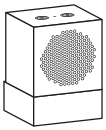
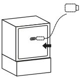
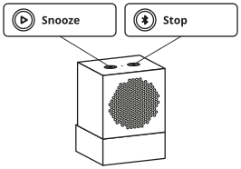

# Kallsup Spotify Alarm Clock

Turns an IKEA KALLSUP speaker into a stand-alone alarm clock that plays one specific Spotify track at a scheduled time. An ESP32-S3 acts as a Spotify Connect device (via [cspot](https://github.com/philippe44/cspot), see [`docs/CSPOT.md`](docs/CSPOT.md)) and starts the track itself through the Spotify Web API. No phone is needed after a one-time setup. If Spotify or Wi-Fi is unavailable, a locally generated beep rings instead.

Requires **Spotify Premium**. Design and phase plan: [`PLAN.md`](PLAN.md).

## User guide

For the person using the clock. Everything technical (Spotify keys, the song, pairing) is set up beforehand, see [Building and setup](#building-and-setup). A German, printable version of this guide is on the device at `http://kallsup-alarm.local/anleitung`.

<p align="center"></p>

### Setting up (once)

1. **Plug the USB cable into the back of the speaker and the power adapter into the wall. Wait 2 minutes.**
   The clock first looks for a Wi-Fi it knows. If it finds none, it opens its own.

   
2. **Connect your phone to the Wi-Fi “Kallsup-Setup”.** There's no password. If the phone warns about “no internet”, choose **stay connected**.
3. **The setup page opens by itself.** If it doesn't, open `http://192.168.4.1` in the browser.
4. **Pick your Wi-Fi, enter its password, tap “Verbinden” (connect).** After about 20 seconds a green **“Verbunden!”** appears. If it says the password is wrong (“Passwort falsch”), just enter it again.
5. **Put your phone back on your normal Wi-Fi and open the clock's page:** `http://kallsup-alarm.local`, best saved as a bookmark. If that doesn't open, use the number address shown after “Verbunden!”, or `http://kallsup-alarm.fritz.box` with a FRITZ!Box.

Done. After moving house or getting a new router, start again at step 1.

### Setting an alarm

1. Open the clock's page (`kallsup-alarm.local`).
2. Switch an alarm on, pick the time and tap the days.
3. Tap **“Speichern”** (save). The top of the page then shows when the next alarm rings.

### The two buttons

<p align="center"></p>

| | Snooze (left) | Stop (right) |
|---|---|---|
| **Alarm ringing** |  ring again later |  alarm off |
| **Music playing** |  pause / play<br> next song<br> previous song |  louder<br> quieter<br> louder until you let go<br> quieter until you let go |

2× and 3× mean: press quickly in a row. To play music, tap the speaker icon in the Spotify app and choose “Kallsup Alarm”.

### Problems?

**Almost always helps:** unplug, wait 10 seconds, plug back in, wait 2 minutes.

| Problem | What to do |
|---|---|
| It beeps instead of playing music | Spotify or the internet wasn't reachable. The beep is on purpose, so you still wake up. |
| The page says “Kein WLAN” (no Wi-Fi) | Is the router on? Otherwise set it up again (step 1). Without Wi-Fi the alarm doesn't ring. |
| The page doesn't open | Is the phone on the same Wi-Fi as the clock? Try the number address from step 5. |
| Too loud or too quiet | Change “Weckerlautstärke” (alarm volume) on the clock's page. |

## Status

| Phase | Content | State |
|---|---|---|
| 0 | Skeleton, partitions, cspot submodule | ✅ verified on hardware |
| 1 | Audio output (I2S, MAX98357A, tone generator) | ✅ verified: clean tone, no click on start/stop, no brownout at max_gain (5 V lab supply) |
| 2 | Wi-Fi, SNTP, mDNS | ✅ verified: reconnects after reboot, NTP time correct, `kallsup-alarm.local` resolves |
| 3 | Settings + web UI | ✅ verified via API: validation, secrets hidden, settings survive reboot |
| 4 | Offline alarm clock (fallback beep) | ✅ verified: scheduled ring, fade-in, snooze, re-ring, auto-stop, web UI tests |
| 5 | Spotify Connect (cspot) | ✅ verified: pairing, playback, stored-credential login after power cycle without phone |
| 6 | Spotify Web API client | ✅ verified: "Test alarm now" plays the track on the Kallsup without a phone |
| 7 | Integration, OTA, hardening | Spotify alarm + 15 s fallback, OTA + rollback verified; awaiting 3-day soak test |

## Repository layout

```
├── PLAN.md                         design + phase plan
├── docs/WIRING.md                  hardware wiring guide
├── tools/get_refresh_token.py      one-time Spotify OAuth helper (runs on a PC)
└── firmware/                       ESP-IDF project
    ├── sdkconfig.defaults          ESP32-S3, 16 MB flash, 8 MB octal PSRAM
    ├── partitions.csv              nvs, otadata, 2 × 4 MB OTA, LittleFS storage
    ├── components/cspot/           git submodule philippe44/cspot, pinned (+ bell), unmodified
    ├── components/cspot_lib/       builds cspot/bell for ESP-IDF, protobuf output, patches
    └── main/                       firmware modules
```

---

## Building and setup

For whoever builds and prepares the clock. Do the steps in order. Steps 1–3 are needed right away; 4–6 apply once the matching firmware phases are done.

### 1. Hardware

Follow [`docs/WIRING.md`](docs/WIRING.md). In short:

1. Move the Kallsup speaker from the board's **P2** connector to the MAX98357A **OUT+ / OUT−**. Never connect either output to GND.
2. Measure Kallsup pad **VCC_5V**: ≈5 V with USB, ≈0 V without. Only if both hold, use it to power the ESP32 5V pin and the amp VIN. Otherwise power from the devkit USB port.
3. Bulk cap (470–1000 µF) across amp VIN/GND.
4. I2S: GPIO 5 → BCLK, 6 → LRC, 7 → DIN, 8 → SD.
5. Optional buttons: GPIO 9 (Snooze) and GPIO 10 (Stop) to GND.
6. Power supply ≥1 A.

### 2. Toolchain (ESP-IDF v5.5)

On Linux (Arch/CachyOS shown; on Debian/Ubuntu use `apt install git wget flex bison gperf python3 python3-venv cmake ninja-build ccache libffi-dev libssl-dev dfu-util libusb-1.0-0`):

```sh
sudo pacman -S --needed gcc git make flex bison gperf python cmake ninja ccache dfu-util libusb

mkdir -p ~/esp && cd ~/esp
git clone -b v5.5 --recursive --depth 1 --shallow-submodules https://github.com/espressif/esp-idf.git
cd esp-idf
./install.sh esp32s3
python3 tools/idf_tools.py install cmake ninja   # only needed if cmake/ninja aren't installed system-wide
```

Each new shell, load the environment:

```sh
. ~/esp/esp-idf/export.sh        # bash/zsh
. ~/esp/esp-idf/export.fish      # fish
```

Serial port access: add yourself to the group that owns `/dev/ttyACM*` (`uucp` on Arch, `dialout` on Debian), then log out and back in:

```sh
sudo usermod -aG uucp $USER
```

### 3. Firmware: clone, build, flash

```sh
git clone --recurse-submodules <this repo> kallsup-alarm
# or, in an existing checkout:
git submodule update --init --recursive

cd kallsup-alarm/firmware
idf.py set-target esp32s3        # first time only; reads sdkconfig.defaults
idf.py build
idf.py -p /dev/ttyACM0 flash monitor
```

Exit the monitor with `Ctrl+]`. If the port isn't found, hold **BOOT**, tap **RST**, release BOOT, and retry. Use the devkit port labelled **USB** (native) or **UART/COM**; both work for flashing.

After changing `sdkconfig.defaults`, delete `firmware/sdkconfig` (or run `idf.py fullclean`) so the new defaults apply.

**Phase 0 check:** the boot log must show

```
I (...) main: PSRAM: 8388608 bytes (8 MB)
```

An error line about PSRAM means the board isn't an N16R8 or octal mode isn't active.

**Debug console.** In `idf.py monitor`, press Enter for the `kallsup>` prompt (`help` lists commands):

| Command | Effect |
|---|---|
| `tone [hz] [ms] [gain]` | Sine tone, default `tone 440 3000 0.3` |
| `stop` | Fade out (20 ms) and stop |
| `max_gain [0..1]` | Show or set the gain cap (default 0.6) |
| `heap` | Free internal / PSRAM heap |
| `ring` / `snooze` / `stop` | Ring the alarm now, snooze it, stop it |
| `alarm` | Alarm state and next alarm |
| `wifi ["ssid" "password"]` | Show Wi-Fi status, or store credentials and reconnect |
| `time` | Local time and whether NTP has synced |
| `tz [POSIX TZ]` | Show or set the time zone (default `CET-1CEST,M3.5.0,M10.5.0/3`) |
| `spotify [forget]` | Spotify login status; `forget` erases the stored login and restarts |

**Phase 1 check:** `tone` should sound clean, with no click at start or end. `tone 60 5000 0.6` (bass at the cap) must not cause a brownout reset.

### 4. Spotify developer app (one-time)

1. Go to <https://developer.spotify.com/dashboard> and log in with the **Premium** account that will own the alarm.
2. **Create app**:
   - APIs: tick **Web API**.
   - Redirect URI: `http://127.0.0.1:8888/callback` — exactly this. Spotify only accepts plain `http` for loopback IPs, not `localhost`.
3. Open the app's **Settings** and note the **Client ID** and **Client secret**.

The app stays in Development Mode, which allows up to 5 users. If Premium lapses, the Web API stops working; the alarm then falls back to the beep.

### 5. Refresh token (one-time, on a PC)

Needs only Python 3, no packages:

```sh
python3 tools/get_refresh_token.py <CLIENT_ID>
# prompts for the client secret (hidden input), opens the browser
```

Log in, approve the scopes `user-read-playback-state` and `user-modify-playback-state`, and the script prints the **refresh token**. Nothing is saved to disk. Treat it like a password.

You can also pass `SPOTIFY_CLIENT_ID` / `SPOTIFY_CLIENT_SECRET` as environment variables.

### 6. Configure the device (from Phase 3 on)

1. On first boot without Wi-Fi credentials (or if Wi-Fi fails for 60 s), the device opens an access point **`Kallsup-Setup`**. Join it and browse to `http://192.168.4.1`.
2. Enter Wi-Fi SSID and password. After it joins your network, the page is at <http://kallsup-alarm.local>.
3. Enter:
   - Spotify client ID, client secret, refresh token (shown later only as "set" / "not set").
   - Track URI: in the Spotify app, *Share → Copy Song Link*, then take the ID from `open.spotify.com/track/<ID>` and enter `spotify:track:<ID>`.
   - Alarms (up to 4: time + weekdays), time zone (default Europe/Berlin), volume cap `max_gain` (default 0.6, keep ≤ 0.7), fade-in, snooze and auto-stop minutes.
4. **Pair once from a phone** (from Phase 5 on): open Spotify, *Connect to a device* → **Kallsup Alarm**, play anything. The device stores its Spotify login and won't need the phone again, even after power loss.
5. Press **Test alarm now** in the web UI. The track should start on the Kallsup.

### 7. Hand it over

The web page and the printable guide are in German, for a non-technical user who only connects it to their own Wi-Fi.

1. Do steps 4–6 yourself, then pair with the Spotify account that will own the alarm, set the track and an alarm.
2. Print the guide: open <http://kallsup-alarm.local/anleitung> → **Drucken** (2 × A4). The same page is linked from the web page under *Hilfe*. It is generated: edit `tools/guide/anleitung.tpl.html` or the line drawings in `tools/guide/sketches.py`, then run `python3 tools/guide/build_guide.py` (needs `qrencode`).
3. Unplug and hand over. At their place the stored Wi-Fi fails, so after 60 s the setup AP `Kallsup-Setup` opens. Its captive portal brings up a Wi-Fi picker on the phone by itself (DNS answers every name with 192.168.4.1, unknown paths redirect to `/`). After a successful connection the page shows the new address, and the AP stays up for 60 s more so the user can read it.

Technical settings (Spotify keys, Wi-Fi fields, device name, time zone, beep test, firmware upload) are under *Erweitert* at the bottom of the web page.

---

## Using it

### How an alarm rings

1. **90 s before:** the device checks Wi-Fi and the Spotify session, refreshes the Web API token and looks up itself in Spotify's device list.
2. **At the alarm time:** it tells Spotify to play your track on itself. Spotify's volume is ignored; the sound fades in locally from silence to *Maximum volume* over *Fade-in*.
3. **Fallback:** if no Spotify audio arrives within 15 s, or the stream stops while ringing, a beep pattern rings instead (also faded in). It's generated on the device and needs no network. It also rings straight away when Wi-Fi, the Spotify login, the Web API setup or the track is missing.
4. **Snooze** (button GPIO 9 or web UI) silences it for *Snooze* minutes. **Stop** (button GPIO 10, web UI, or pausing it in the Spotify app) ends it. After *Stop automatically after* minutes it stops by itself.
5. **No time sync:** without a clock synced since boot, alarms don't ring at all, rather than at a guessed time. The LED blinks red.

Outside an alarm, the Snooze button controls Spotify while the clock is the active player: one click plays/pauses, two clicks skip to the next track, three go back (or restart the track if it's past its first 3 s). The Stop button sets the volume: one click raises it, two lower it, by 1/16 each; keep the last press held and it keeps stepping (every 200 ms, after 400 ms) until you let go. Any other hold counts as one click. Clicks count as a series while each follows the last within 350 ms, so every button acts 350 ms after its last release.

### Status LED (onboard RGB, GPIO 48)

| LED | Meaning |
|---|---|
| very dim green | idle, everything OK |
| warm white, breathing | ringing |
| dim blue, slow pulse | snoozed |
| dim yellow | Web API set up, but the Spotify session isn't logged in (alarms would use the beep) |
| red, blinking | no Wi-Fi, or no time sync: check your network |

If your board's LED stays dark, it may be on GPIO 38. Change `STATUS_LED` in `firmware/main/board_pins.h`.

### Firmware updates (OTA)

1. Build with `idf.py build`.
2. On the web page under *Erweitert → Firmware*, upload `firmware/build/kallsup-alarm.bin`. The device restarts; the new version is shown with `(ota_x, pending verify)`, then `valid` once Wi-Fi and time work.
3. If the new firmware doesn't reach Wi-Fi and time within 5 minutes, it restarts and the bootloader rolls back to the previous version.
4. Updates are refused while an alarm rings. A USB flash (`idf.py flash`) always works as a fallback.

### Self-healing

- **Wi-Fi:** reconnects with back-off (5, 10, 20, 40, 60 s). After 60 s without connection, the setup AP `Kallsup-Setup` opens alongside.
- **Task watchdog:** if the alarm or audio task hangs for 10 s, the device reboots.
- **Daily check at 04:00:** if the Spotify session isn't logged in, or Spotify no longer lists the device, the device restarts to log in afresh.

### Soak test (Phase 7 check)

1. Set a daily alarm for the next three days and let it run.
2. Once, pull the router's power a few minutes before an alarm. The beep must ring on time, then the device must reconnect by itself when the router is back.
3. Check `/api/status` (or the web page) for unexpected restarts: a small *uptime* means one happened.

---

## License

cspot is GPLv3, so firmware built with it is a GPLv3 work. Distributing the firmware means offering its source under GPLv3. Details in [`docs/CSPOT.md`](docs/CSPOT.md).

## Security

Never commit Wi-Fi passwords, the Spotify client secret or refresh tokens. They live only in the device's NVS. `.gitignore` excludes `sdkconfig`, build output and `secrets*` files.

- **No login on the web page:** anyone on your home network can change settings, ring or stop alarms and **upload firmware**. Secrets are never sent to the browser. POSTs require `application/json` or `application/octet-stream`, so other websites can't trigger them through your browser (CORS preflight). Keep the device on a network you trust.
- **Setup AP:** `Kallsup-Setup` is an open network. It only appears while Wi-Fi isn't connected.
- **TLS:** all HTTPS connections, including cspot's, verify certificates against ESP-IDF's CA bundle.

## Known risks

- cspot can break when Spotify changes its protocol. The submodule is pinned, and the offline beep alarm always works.
- See `PLAN.md` section 6 for more.
