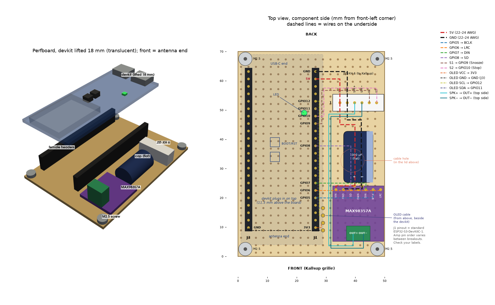

# Wiring

Hardware setup for the Kallsup Spotify Alarm Clock. See `PLAN.md` section 1 for the reasoning behind each choice.

## Parts

| Part | Notes |
|---|---|
| ESP32-S3 **N16R8** devkit | 16 MB flash, 8 MB octal PSRAM |
| MAX98357A breakout | I2S class-D amp, mono |
| IKEA KALLSUP | PCB used only as USB-C 5 V input; its speaker (4 Ω, 3 W) is reused |
| 470–2200 µF electrolytic cap, ≥10 V | Across MAX98357A VIN/GND. 100 µF alone is too small. |
| 2 push buttons (optional) | Snooze / Stop |
| 0.96" I2C OLED, SSD1306, 128 × 64 (e.g. JMD0.96D) | Optional status display in the front of the base, address 0x3C |
| USB-C power supply, ≥1 A | |

## Perfboard layout



The 50 × 70 mm perfboard that sits in the base (`hardware/enclosure/`). Left: 3D view, with the devkit drawn lifted off its female headers. Right: top view to scale, in mm from the front-left corner; each wire has its own colour, and dashed lines run on the underside. The buttons and the speaker reach the board through the 6-pin JST-XH connector. Regenerate it in `hardware/enclosure/` with `python render_perfboard.py . out/perfboard_layout.png` (needs build123d, pyvista and matplotlib).

## Diagram

```
 KALLSUP PCB                     ESP32-S3 N16R8                  MAX98357A
 ───────────                     ──────────────                  ─────────
 VCC_5V ──────────┬───────────── 5V
                  └───────────────────────────────────────────── VIN ─┐
                                                                     (+)
                                                          cap 470–2200 µF
                                                                     (−)
 GND1 ────────────┬───────────── GND                                  │
                  └───────────────────────────────────────────── GND ─┘
                                 GPIO 5  ─────────────────────── BCLK
                                 GPIO 6  ─────────────────────── LRC
                                 GPIO 7  ─────────────────────── DIN
                                 GPIO 8  ─────────────────────── SD
                                                                 GAIN  (unconnected = 9 dB)
                                 GPIO 9  ──[Snooze]── GND        OUT+ ──┐
                                 GPIO 10 ──[Stop]──── GND        OUT− ──┤ KALLSUP speaker
                                                                        └ (was on Kallsup P2)
                                                                 OLED
                                                                 ────
                                 3V3     ─────────────────────── VCC
                                 GND     ─────────────────────── GND
                                 GPIO 11 ─────────────────────── SDA
                                 GPIO 12 ─────────────────────── SCL
```

## Pin map

| Signal | ESP32-S3 GPIO | MAX98357A pin |
|---|---|---|
| I2S BCLK | 5 | BCLK |
| I2S WS / LRCLK | 6 | LRC |
| I2S DATA | 7 | DIN |
| Amp enable | 8 | SD (LOW = shutdown, HIGH = on) |
| 5 V | 5V | VIN |
| GND | GND | GND |
| Snooze button | 9 (internal pull-up, active LOW) | — |
| Stop button | 10 (internal pull-up, active LOW) | — |
| OLED SDA | 11 | — |
| OLED SCL | 12 | — |
| Status LED | onboard RGB, usually 48 (some boards use 38) | — |

**Do not use** on N16R8: GPIO 26–32 (flash), 33–37 (octal PSRAM), 19/20 (USB), strapping pins 0, 3, 45, 46.

## Steps

### 1. Speaker
1. Unplug the speaker from the Kallsup board's **P2** connector.
2. Connect its two wires to the MAX98357A **OUT+ / OUT−** screw terminals. Polarity only matters for phase, not safety.
3. **Never connect OUT+ or OUT− to GND.** The outputs are bridge-tied (BTL); grounding one shorts the amp.

### 2. Verify the Kallsup 5 V pad
With a multimeter between test pads **VCC_5V** and **GND1**:

| Condition | Expected |
|---|---|
| USB-C plugged in | ≈5 V |
| USB unplugged, battery connected | ≈0 V |

- **Both hold:** VCC_5V is raw USB VBUS. Wire it to the ESP32 **5V** pin and the MAX98357A **VIN**, and GND1 to both GNDs.
- **Battery voltage shows without USB:** stop. Don't use the pad. Power everything from the devkit's own USB port instead (devkit 5V pin → MAX98357A VIN).

The battery can stay plugged into the Kallsup board; v1 doesn't use it.

### 3. Bulk capacitor
Solder the 470–2200 µF capacitor across MAX98357A **VIN (+)** and **GND (−)**, as close to the breakout as possible. Mind the polarity stripe (−).

### 4. I2S and enable
Four wires from the devkit to the amp: GPIO 5 → BCLK, 6 → LRC, 7 → DIN, 8 → SD. Leave GAIN unconnected.

### 5. Buttons (optional)
Each button between its GPIO and GND. No external resistors needed; the firmware enables internal pull-ups.

**Reusing the Kallsup buttons:** test pads **S1** and **S2** are wired to the Bluetooth chip. With USB connected, measure each pad released and pressed. Only wire a pad to a GPIO if it switches between a level **≤3.3 V** and GND. If it switches to battery voltage or sits on a resistor ladder, use separate buttons.

### 6. Power supply
At least **1 A**. Peak draw at 3 W into 4 Ω is about 1 A. Brownout resets on loud passages mean the supply or the cap is too small.

**Don't feed the amp from the devkit's 5V pin while the devkit runs on a PC USB port.** In testing, the amp cut out about 49 times per second at gain ≥0.3 (an audible flutter), although average draw was only ~50 mA. The same amp on a 5 V lab supply played cleanly. The PC port and the devkit's diode/fuse in the 5V path can't deliver the current peaks. For bench tests, power the amp from a separate 5 V supply (shared GND with the devkit); in the final build, feed it from VCC_5V with short, thick wires.

### 7. Display (optional)
Four wires: **VCC → 3V3** (not 5V), GND → GND, SDA → GPIO 11, SCL → GPIO 12. On the perfboard the cable comes down beside the devkit's right edge, through four holes next to J1 pin 1, and runs on the underside to J1 pin 1 (3V3), J1 pins 17/18 (GPIO 11/12) and J3 pin 1 (GND); see the layout above. The module's own pull-ups go to VCC, so at 3.3 V the bus stays at the ESP32's level; no extra resistors. Without a display the firmware logs `no display at 0x3c` and runs on. The firmware is set for a module mounted with its JST connector at the bottom (`ROTATE_180 = true` in `firmware/main/display.cpp`); mounted the other way round, set it to `false`.

In the base, the module stands behind the window in the front wall, pins at the top. With the shell upside down, slide it into the two rails from the open side, glass first, until it stops under the lid. Then fit the perfboard, which keeps it from dropping out. The 4-pin JST-XH on the back of the module, at its top edge, has room above and behind it for the plug; there is no room behind the lower part.

## Speaker protection
The MAX98357A at 5 V can deliver more than 3 W into 4 Ω. The firmware caps output with `max_gain` (default 0.6). Keep it at or below **0.7** unless you've tested higher and the speaker doesn't distort or get warm.
